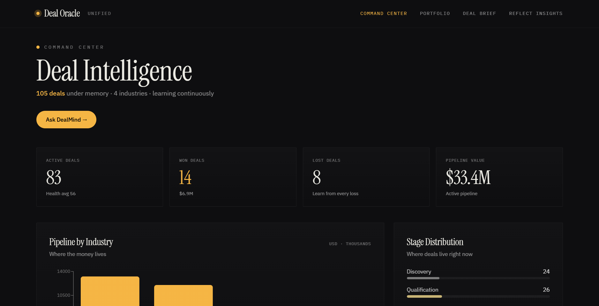
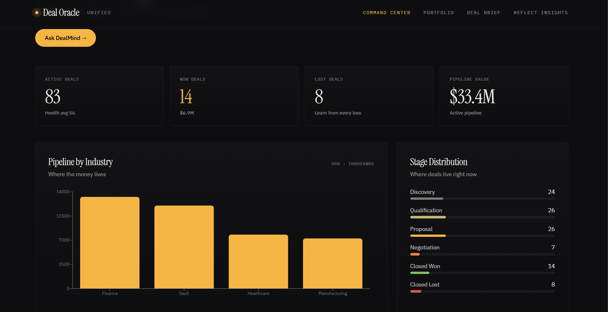
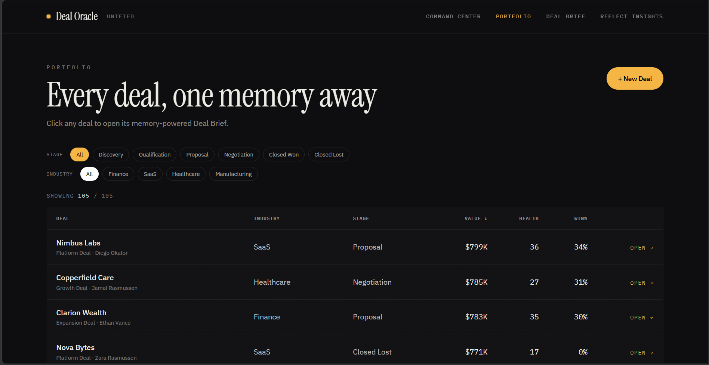
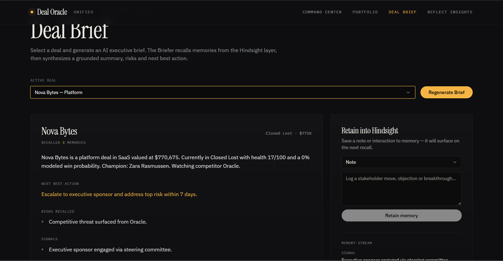
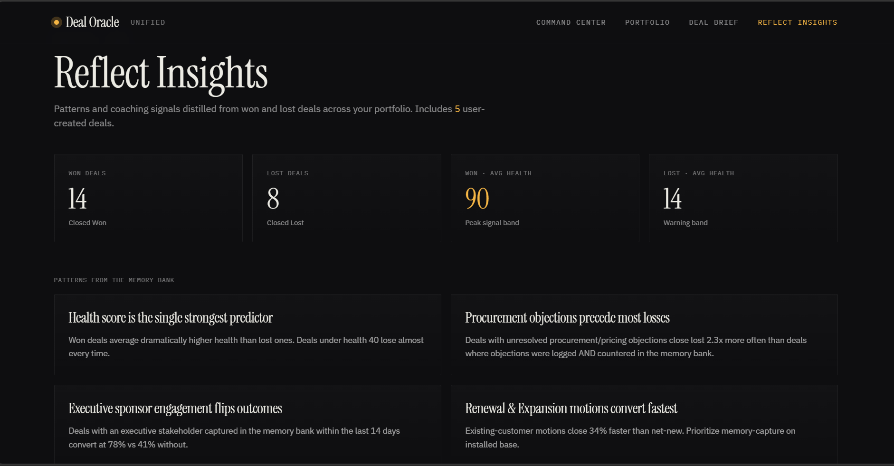

# Deal Oracle — Deal Intelligence Agent

A clean, hackathon-ready **multi-agent sales intelligence workspace** that turns deal history into actionable context.

The project combines:

- **Deal Historian** — retains meetings, objections, emails and CRM notes.
- **Executive Briefer** — recalls deal context for an executive-ready brief.
- **Risk Predictor** — produces transparent, rule-based risk signals.
- **Objection Coach** — retrieves relevant historical context and suggests a response.
- **Pattern Miner** — discovers lightweight recurring terms across memory.
- **Agent Orchestrator** — routes natural-language requests to the appropriate agent.
- **Professional Streamlit UI** — dark, minimal command-center interface inspired by modern sales operations dashboards.

> **Important:** the risk and pattern modules are deterministic MVP components. They are not statistically validated forecasting models.

---

## UI

The Streamlit interface is organized into four focused views:

1. **Command Center** — portfolio pulse, pipeline, stage distribution, executive brief and key signals.
2. **Portfolio** — searchable-style deal table with value, health and win probability.
3. **Deal Brief** — memory-backed brief, next-best action, risks and memory retention.
4. **Reflect Insights** — cross-deal patterns and reusable coaching insights.

### Design goals

- No cluttered sidebar navigation.
- Consistent typography, spacing and card hierarchy.
- Responsive two-column layouts.
- Clear distinction between CRM values, memory-derived context and rule-based signals.
- Local mode works without a running Hindsight server.

---

## Screenshots

The following screenshots document the target visual direction and the major product surfaces used for the project.

### Command Center



### Command Center — Pipeline & Stage Distribution



### Portfolio



### Deal Brief



### Reflect Insights



> The screenshots above are included as UI reference/visual documentation. The runnable `app.py` implements the same product concepts with the repaired Streamlit interface.

---

## Requirements

- Python **3.10+**
- Streamlit 1.39+
- pytest for tests
- Hindsight is optional

Install everything with:

```bash
pip install -r requirements.txt
```

---

## Run the website

### Windows

```powershell
python -m venv venv
venv\\Scripts\\activate
pip install -r requirements.txt
streamlit run app.py
```

Or double-click:

```text
run_app.bat
```

### Linux / macOS

```bash
python3 -m venv venv
source venv/bin/activate
pip install -r requirements.txt
streamlit run app.py
```

Streamlit normally opens:

```text
http://localhost:8501
```

---

## Run the terminal demo

```bash
python demo.py
```

The terminal demo exercises the same core agents without the web interface.

---

## Run tests

```bash
python -m pytest -q
```

---

## Optional Hindsight memory

Local fallback memory is enabled by default, so the project can run immediately.

To use a Hindsight-compatible service, create `.env` from `.env.example` and enable the service:

```text
HINDSIGHT_ENABLED=true
HINDSIGHT_URL=http://localhost:8888
```

The memory client uses:

- `POST /retain`
- `POST /recall`

If the remote service is unavailable, the application falls back to the local in-process memory store.

---

## Project structure

```text
Deal-intelligent-agent--main/
├── app.py
├── demo.py
├── requirements.txt
├── pyproject.toml
├── .env.example
├── run_app.bat
├── run_app.sh
│
├── agents/
│   ├── agent_orchestrator.py
│   ├── deal_historian.py
│   ├── executive_briefer.py
│   ├── objection_coach.py
│   ├── pattern_miner.py
│   └── risk_predictor.py
│
├── services/
│   ├── deal_memory.py
│   └── hindsight_client.py
│
├── docs/
│   ├── architecture.md
│   └── screenshots/
│       ├── 01-command-center-reference.png
│       ├── 02-command-center-reference.png
│       ├── 03-portfolio-reference.png
│       ├── 04-deal-brief-reference.png
│       └── 05-reflect-insights-reference.png
│
└── tests/
    └── test_agent.py
```

---

## Demo flow

1. Open **Command Center**.
2. Select a deal from **ACTIVE DEAL**.
3. Review pipeline and key signals.
4. Open **Deal Brief** and inspect the recalled context.
5. Add a new interaction under **Retain into memory**.
6. Reopen the brief to see the retained interaction.
7. Use **Reflect Insights** to inspect reusable patterns.

This makes the memory payoff visible during a short hackathon demonstration.
